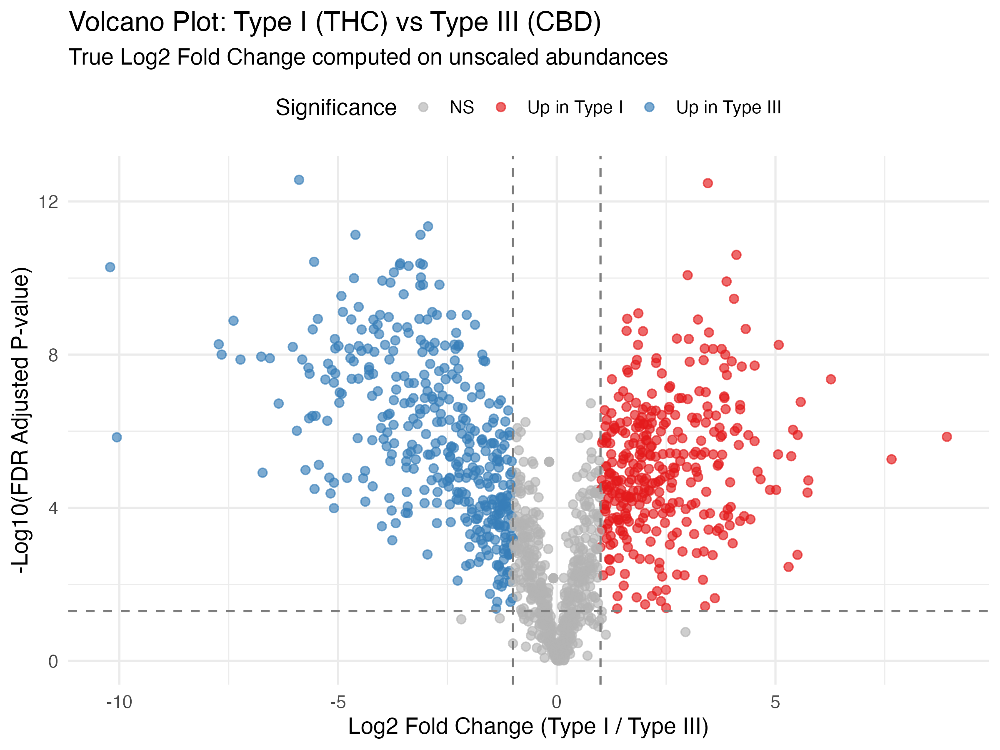
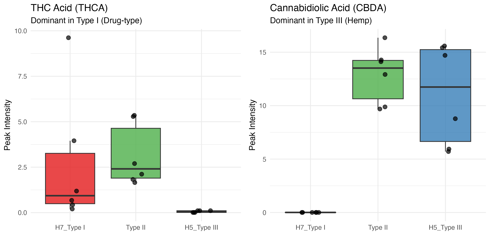
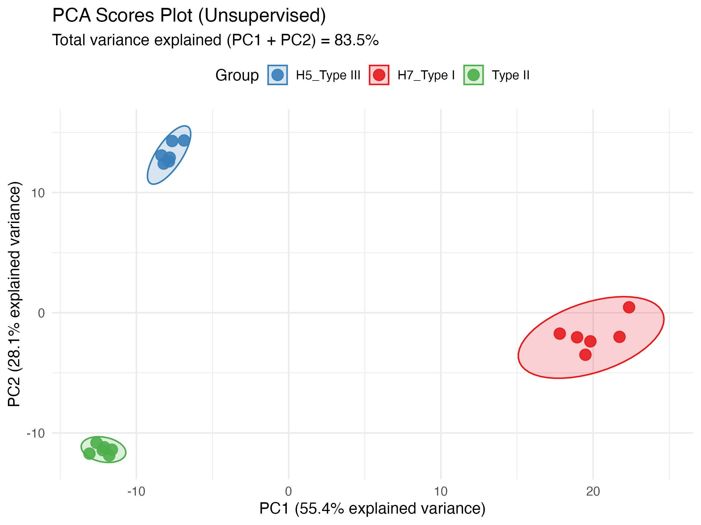
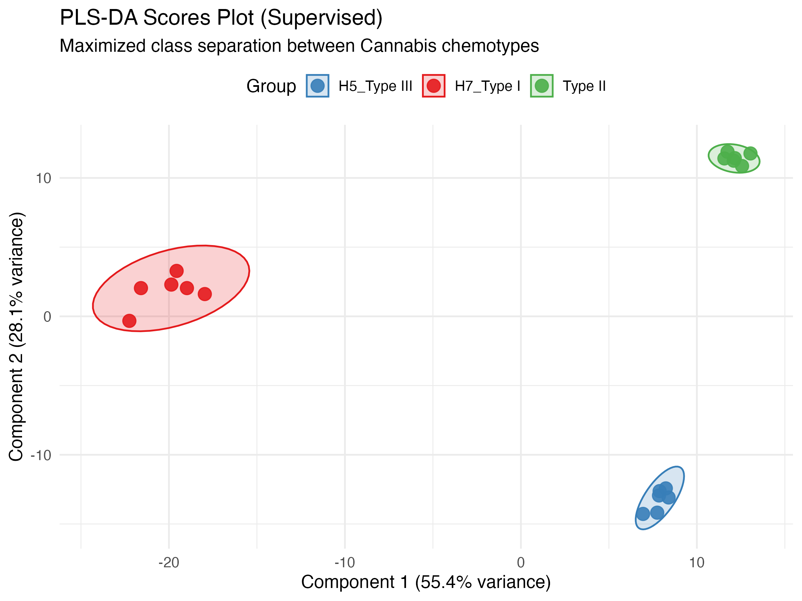
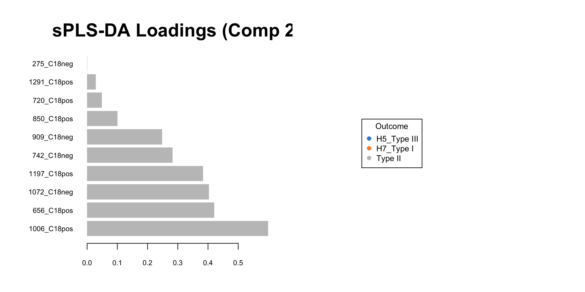
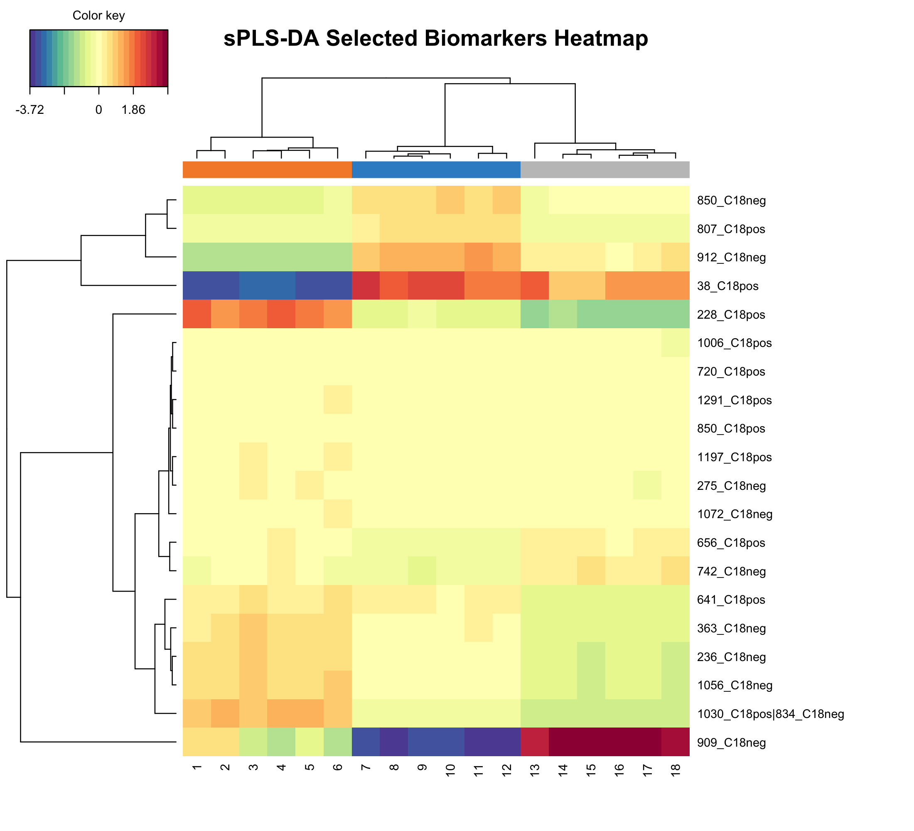

# MetaboStat: Student Tutorial & Practical Manual
## Univariate, Multivariate Analysis & Metabolomics Data Mining

**Platform**: MetaboStat (MSnet-Stat Student Edition)  
**Author / Lab**: Guillaume Marti (Toulouse University, Metatoul-AgromiX)  
**Target Audience**: Students in Analytical Chemistry, Bioinformatics, Systems Biology, and Metabolomics  
**Case Study Dataset**: *Cannabis sativa* Chemotype Profiling (`Dataset/Cannabis/`)

---

## Table of Contents

1. [Introduction to Metabolomics Data Mining](#1-introduction-to-metabolomics-data-mining)
2. [Quick Installation & Launch (Mac & Windows)](#2-quick-installation--launch-mac--windows)
3. [The Case Study: Cannabis Chemotypes](#3-the-case-study-cannabis-chemotypes)
4. [Step 1: Data Import & Metadata Association](#4-step-1-data-import--metadata-association)
5. [Step 2: Preprocessing – Mastering the Matrix](#5-step-2-preprocessing--mastering-the-matrix)
6. [Step 3: Univariate Statistical Analysis](#6-step-3-univariate-statistical-analysis)
   - 6.1 ANOVA vs Kruskal-Wallis & P-value Correction (FDR)
   - 6.2 Pairwise Volcano Plot Contrast
   - 6.3 Post-Hoc Tests & Boxplots (Tukey HSD)
7. [Step 4: Unsupervised Multivariate Analysis – PCA](#7-step-4-unsupervised-multivariate-analysis--pca)
   - 7.1 Principle & Scree Plot
   - 7.2 Scores Plot & Natural Grouping
   - 7.3 PERMANOVA & Silhouette Validation
8. [Step 5: Supervised Classification – PLS-DA](#8-step-5-supervised-classification--pls-da)
   - 8.1 The Supervised Principle
   - 8.2 Overfitting & Cross-Validation (BER, Error Rate, AUROC)
9. [Step 6: Biomarker Discovery – sPLS-DA](#9-step-6-biomarker-discovery--spls-da)
   - 9.1 The Sparsity Principle ($L_1$ Penalty / LASSO)
   - 9.2 Tuning `keepX`
   - 9.3 Loadings & Clustered Image Maps (Heatmaps)
10. [Step 7: Bidirectional Workflow & Biological Synthesis](#10-step-7-bidirectional-workflow--biological-synthesis)
11. [Summary Cheatsheet & Student Self-Check](#11-summary-cheatsheet--student-self-check)

---

## 1. Introduction to Metabolomics Data Mining

Untargeted metabolomics by Liquid Chromatography coupled to High-Resolution Mass Spectrometry (LC-HRMS) yields complex datasets. A typical experiment produces a data matrix where:
- **Rows** represent experimental samples ($N$).
- **Columns** represent chemical features ($P$, characterized by a retention time $RT$ and a mass-to-charge ratio $m/z$).

Because untargeted profiling measures thousands of features ($P \gg N$) with varying concentration ranges, instrumental noise, and missing values, raw data cannot be interpreted directly. 

**Data Mining** in metabolomics combines two complementary philosophies:
1. **Univariate Analysis**: Tests each chemical feature individually for statistical significance across experimental groups (e.g., ANOVA, Volcano plots).
2. **Multivariate Analysis**: Analyzes the joint correlation structure of all features simultaneously to discover overarching patterns, clusters, and predictive biomarker signatures (e.g., PCA, PLS-DA, sPLS-DA).

**MetaboStat** is designed to seamlessly integrate both approaches with interactive visualization and bidirectional filtering.

---

## 2. Quick Installation & Launch (Mac & Windows)

### 2.1 Prerequisites
Students must have:
- **R (version ≥ 4.0, latest 4.3 or 4.4 recommended)**: [Download R](https://cloud.r-project.org/)
- **RStudio Desktop**: [Download RStudio](https://posit.co/download/rstudio-desktop/)

### 2.2 Automated Installation (Recommended)
Open RStudio, set your working directory to the folder containing this tutorial, and run in the R console:

```r
source("install_dependencies.R")
```

This automated script will:
1. Detect whether you are running **macOS** or **Windows**.
2. Install required CRAN packages (`shiny`, `ggplot2`, `dplyr`, `vegan`, `DT`, `ggpubr`, `scales`, etc.).
3. Install the Bioconductor package `mixOmics` via `BiocManager`.
4. Run a diagnostic self-check and verify that every library loads properly.

> [!NOTE]
> Older metabolomics scripts relied on the archived CRAN package `MetabolAnalyze`. In this student version, **Pareto scaling** is computed natively in base R, avoiding package installation failures.

### 2.3 Launching the Application
You can launch the platform through any of the following methods:
- **In RStudio**: Open `app.R` and click the green **"Run App"** button at the top right of the editor.
- **In the R console**:
  ```r
  shiny::runApp()
  ```
  or
  ```r
  source("run_app.R")
  ```
- **From Finder / File Explorer**:
  - **macOS**: Double-click `run_mac.command`.
  - **Windows**: Double-click `run_windows.bat`.

---

## 3. The Case Study: Cannabis Chemotypes

Throughout this tutorial, we analyze an authentic metabolomics dataset located in `Dataset/Cannabis/`:

| File | Role | Description |
|---|---|---|
| `StatTableNEGPOS.csv` | **Statistical Data** | 18 samples $\times$ 1277 metabolic features (peak intensities combining positive and negative ionization). |
| `NodesNEGPOS.csv` | **Feature Metadata** | 1276 annotated spectral nodes (metabolite names, $m/z$, retention time, chemical superclass, and confidence levels). |

### Biological Background: The Three Chemotypes
*Cannabis sativa* plants exhibit three well-established genetic chemotypes dictated by the cannabinoid biosynthesis pathway:

```
              Geranyl Pyrophosphate (GPP) + Olivetolic Acid (OA)
                                      │
                                      ▼
                          Cannabigerolic Acid (CBGA)
                                      │
                 ┌────────────────────┴────────────────────┐
                 ▼                                         ▼
            THCA Synthase                             CBDA Synthase
                 │                                         │
                 ▼                                         ▼
   Δ9-Tetrahydrocannabinolic Acid (THCA)       Cannabidiolic Acid (CBDA)
            [Drug-type / Psychoactive]           [Hemp / Non-intoxicating]
```

- **Type I (`H7_Type I`)**: THC-dominant ($[\text{THCA}] \gg [\text{CBDA}]$, ratio $> 10$). Used in medicinal/recreational drug cultivars.
- **Type II (`Type II`)**: Intermediate / balanced chemotype ($[\text{THCA}] \approx [\text{CBDA}]$, ratio $0.5 - 2$). Both enzymes are functional.
- **Type III (`H5_Type III`)**: CBD-dominant ($[\text{CBDA}] \gg [\text{THCA}]$, ratio $> 10$). Characteristic of industrial hemp cultivars.

**Your Mission as an Analyst**: Demonstrate how univariate tests, unsupervised PCA, and supervised sPLS-DA separate these three chemotypes and pinpoint the diagnostic biomarkers.

---

## 4. Step 1: Data Import & Metadata Association

### 4.1 Loading the Statistical Matrix
1. In the left sidebar under **1. Data Input**, click **Browse...** and select:
   `Dataset/Cannabis/StatTableNEGPOS.csv`
2. **Separator**: The app automatically detects the comma (`,`).
3. **Grouping Column**: Select `Class` from the dropdown. This assigns the experimental labels (`H7_Type I`, `Type II`, `H5_Type III`).

### 4.2 Loading the Feature Metadata
1. Under **2. Feature Metadata (Optional)**, click **Browse...** and select:
   `Dataset/Cannabis/NodesNEGPOS.csv`
2. **Metadata Separator**: The app auto-detects Tab (`\t`).
3. **Feature ID Column**: Select `Alignment ID`. 
   > [!TIP]
   > The app includes an intelligent matching algorithm (`guess_feature_id_col`) that automatically inspects metadata columns and selects the one with the highest match rate. For this dataset, `Alignment ID` matches 1276 out of 1277 features (>99.9%).
4. Click **Verify Matching**: You should see:
   ```
   Data features: 1277
   Metadata entries: 1276
   Matched features: 1276
   Match percentage: 99.9%
   ```
5. Click the blue button **"Validate All Data"**.

---

## 5. Step 2: Preprocessing – Mastering the Matrix

Raw mass spectrometry peak intensities cannot be compared directly without proper transformation and scaling.

```
   Raw Intensities (Heteroscedastic, high dynamic range)
                           │
                           ▼
  1. Imputation: None / Min/10 (Detection limit replacement)
                           │
                           ▼
  2. Normalization: None / TSS (Total Sum Scaling for dilution)
                           │
                           ▼
  3. Transformation: Log10(x+1) (Stabilizes variance & skewness)
                           │
                           ▼
  4. Scaling: Center / UV / Pareto (Weights trace vs abundant peaks)
```

### Preprocessing Choices Explained:
- **Missing Value Imputation**:
  - `Min/10`: Replaces zeros/NAs with one-tenth of the lowest measured intensity (proxy for the limit of detection).
- **Normalization (Sample-wise)**:
  - `TSS (Total Sum Scaling)`: Divides each feature intensity by the sum of all intensities in that sample, correcting for biological dilution differences. The result is rescaled to the median total signal of the dataset, so intensities keep their original magnitude (otherwise `Log10(x+1)` of tiny fractions would be almost linear and CLR pseudo-counts would dominate).
- **Transformation (Feature-wise)**:
  - `Log10(x+1)`: Compresses the extreme dynamic range of MS detectors and normalizes right-skewed distributions.
- **Scaling (Feature-wise)**:
  - **Centering only**: $\tilde{x} = x - \bar{x}$. Preserves absolute intensity variance. High-abundance metabolites dominate all models.
  - **Unit Variance (UV)**: $\tilde{x} = \frac{x - \bar{x}}{\text{sd}(x)}$. All features have equal variance $= 1$. Noise and trace metabolites are amplified equally with major peaks.
  - **Pareto Scaling**: $\tilde{x} = \frac{x - \bar{x}}{\sqrt{\text{sd}(x)}}$. **The metabolomics standard**. Divides by the square root of the standard deviation. Moderate metabolites gain influence without over-amplifying background baseline noise.

> **Recommended Settings for this Tutorial**:
> - Imputation: `None` or `Min/10`
> - Normalization: `None` (samples are normalized peak areas)
> - Transformation: `Log10(x+1)` (or `None`)
> - Scaling: `Pareto`

---

## 6. Step 3: Univariate Statistical Analysis

Navigate to the **Univariate** tab in the main panel.

### 6.1 ANOVA vs Kruskal-Wallis & P-value Correction (FDR)
- If your data approximates a normal distribution after log-transformation, use **ANOVA** (parametric). If distributions remain non-normal, check **Non-parametric tests** (Kruskal-Wallis).
- **The Multiplicity Problem**: Testing 1277 features simultaneously at $\alpha = 0.05$ will produce $1277 \times 0.05 \approx 64$ false positives purely by chance.
- **Benjamini-Hochberg (FDR)**: Adjusts raw p-values ($q$-value) to control the proportion of false discoveries. Keep `FDR` selected and threshold at `0.05`.

Notice in the **Univariate test results** table: over 1190 features differ significantly across the three chemotypes, demonstrating vast metabolic reorganization between hemp and drug types!

### 6.2 Pairwise Volcano Plot Contrast
Click on the **Volcano** subtab. A volcano plot combines two essential metrics for every metabolite:
1. **Biological Effect Size (x-axis)**: The **Log2 Fold Change** ($\log_2(\text{FC})$) between two groups:
   $$\log_2(\text{FC}) = \log_2\left(\frac{\overline{\text{Abundance}}_{\text{Group 2}} + \epsilon}{\overline{\text{Abundance}}_{\text{Group 1}} + \epsilon}\right)$$
   A value of $+1$ represents a 2-fold increase ($2\times$), $+2$ represents a 4-fold increase ($4\times$), and $-1$ represents a 2-fold decrease ($0.5\times$).
2. **Statistical Significance (y-axis)**: The negative logarithm of the adjusted p-value ($-\log_{10}(p_{\text{adj}})$). Higher values indicate stronger statistical evidence against the null hypothesis.

> [!IMPORTANT]
> **The Volcano Scaling Pitfall**: In metabolomics, multivariate methods (PCA, PLS-DA) require Pareto or UV scaling. However, **a Volcano plot must always compute Fold Change on unscaled abundances** (raw or normalized peak areas)!
> If Fold Change were computed on centered or Pareto-scaled z-scores, subtracting means would measure standard deviation shifts rather than biological ratios, severely distorting the volcano shape into an artificial vertical column. MetaboStat automatically tracks the unscaled abundance matrix behind the scenes to guarantee authentic, scale-invariant Log2FC values.

Select:
- **Group 1**: `H5_Type III` (CBD hemp)
- **Group 2**: `H7_Type I` (THC drug-type)
- **Threshold |Log2FC|**: `1.0` (corresponds to a 2-fold difference)
- **Threshold -Log10(p)**: `1.3` (corresponds to $p_{\text{adj}} \le 0.05$)



Notice the clear, symmetric "wings" of the volcano:
- **Right upper quadrant (Red - Up in Type I)**: Features significantly over-accumulated in drug-type cannabis, including **$\Delta^9$-THCA** ($\log_2(\text{FC}) = +5.50$, over **45-fold** higher).
- **Left upper quadrant (Blue - Up in Type III)**: Features significantly over-accumulated in fiber-type hemp, including **CBDA** ($\log_2(\text{FC}) = -10.06$, over **1000-fold** higher).
- **Central grey points**: Features with small fold changes ($|\log_2(\text{FC})| < 1$) or non-significant differences ($p_{\text{adj}} > 0.05$).

### 6.3 Post-Hoc Tests & Boxplots (Tukey HSD)
Click on the **Boxplot/Violin** subtab. When ANOVA reveals a significant feature across 3 groups, which specific groups differ from each other?
MetaboStat runs **Tukey's Honest Significant Difference (HSD)** post-hoc test and displays **compact letter displays**:
- Groups sharing the same letter (e.g., `a` and `a`) are **not** statistically significantly different.
- Groups with different letters (e.g., `a` vs `b`) differ significantly ($p < 0.05$).



- **THCA (`1129_C18neg|1461_C18pos`)**: Highest in `H7_Type I`, intermediate in `Type II`, absent in `H5_Type III`.
- **CBDA (`1123_C18neg|1447_C18pos`)**: Extremely high in `H5_Type III` and `Type II`, absent in `H7_Type I`.

---

## 7. Step 4: Unsupervised Multivariate Analysis – PCA

Navigate to the **Multivariate** tab and click on the **PCA** subtab.

### 7.1 Principle & Scree Plot
Principal Component Analysis (PCA) performs orthogonal linear transformation to project high-dimensional data (1277 variables) onto a few uncorrelated Principal Components (PCs) that maximize captured variance, **without using class labels**.

Look at the **Scree Plot**:
- **PC1** explains **55.4%** of total variance.
- **PC2** explains **28.1%** of total variance.
- Together, the first two dimensions capture **83.5%** of the entire dataset's variance!

### 7.2 Scores Plot & Natural Grouping
Look at the **PCA Scores Plot**:



1. **PC1 (55.4%)** cleanly separates **Type I (red)** from **Type III (blue)**, aligning with the primary cannabinoid axis (THC vs CBD accumulation).
2. **PC2 (28.1%)** isolates the **Type II (green)** chemotype along the vertical axis, reflecting its unique hybrid metabolic signature where both pathways are actively synthesized.
3. The 95% confidence ellipses show that the samples cluster tightly into three distinct, non-overlapping chemical profiles.

### 7.3 PERMANOVA & Silhouette Validation
- **PERMANOVA (adonis2)**: Tests whether multivariate distance differs significantly between groups ($p < 0.001$, $R^2 > 0.85$).
- **Silhouette plot**: Measures cluster tightness and separation. Average silhouette widths $> 0.70$ indicate strong, natural clustering.

---

## 8. Step 5: Supervised Classification – PLS-DA

Click on the **PLS-DA** subtab.

### 8.1 The Supervised Principle
Unlike PCA (unsupervised), Partial Least Squares Discriminant Analysis (PLS-DA) is **supervised**: it is provided with the class labels ($Y$) and finds latent components that maximize the covariance between the metabolic variables ($X$) and the classes ($Y$).



Notice how the classes separate even more crisply than in PCA.

### 8.2 The Danger of Overfitting & Cross-Validation
> [!WARNING]
> Because PLS-DA is supervised, it can easily "force" separation even on random noise if $P \gg N$! **Never interpret a PLS-DA scores plot without cross-validation metrics!**

In the sidebar or right column:
1. Select **CV: M-fold**, Folds: `5`, Repeats: `50`.
2. Click **"Performance"**.
3. Inspect the **Classification error rate** and **Balanced Error Rate (BER)**:
   - For this Cannabis dataset, both Overall Error Rate and BER drop to **0.000** at Component 2!
   - This proves the discrimination is biologically genuine, robust, and not an artifact of overfitting.
4. Inspect the **Comp AUC** plot: AUROC $= 1.00$ for all three classes.

---

## 9. Step 6: Biomarker Discovery – sPLS-DA

While PLS-DA achieves 100% classification accuracy, it still uses all 1277 features. In clinical, forensic, or industrial applications, we want a **minimal signature of true biomarkers**.

Click on the **sPLS-DA** subtab.

### 9.1 The Sparsity Principle ($L_1$ LASSO Penalty)
Sparse PLS-DA (sPLS-DA) applies an $L_1$ penalty to shrink the loadings of uninformative features to exactly zero. Only the top `keepX` most discriminative features are selected per component.

### 9.2 Tuning `keepX`
1. Under sidebar section **6. Multivariate Parameters**, leave **sPLS-DA** on `Auto` and Strategy on `Sparse`.
2. Click **"Run Tuning"**.
3. MetaboStat tests feature subsets (e.g. 5, 10, 15, 20...) using repeated cross-validation to find the minimal feature set yielding the lowest BER.
4. For Cannabis, selecting 10 to 15 features per component suffices to achieve perfect classification!

### 9.3 Loadings Plots
The Loadings plots display the weights and contributions of each selected feature:



- **Component 1**: Displays features distinguishing Type I from Type III, colored by the group where their abundance is maximal.
- **Component 2**: Displays features that uniquely characterize the intermediate Type II chemotype.

### 9.4 Biomarker Heatmap (Clustered Image Map / CIM)
Scroll down to **Heatmap of Selected Biomarkers**:



- **Columns**: Grouped samples with colored banners (Red = Type I, Green = Type II, Blue = Type III).
- **Rows**: The selected biomarker features, hierarchically clustered.
- The heatmap provides an immediate visual summary of the diagnostic metabolic fingerprint: blocks of intense red (high expression) and blue (low expression) delineate each chemotype with zero ambiguity.

---

## 10. Step 7: Bidirectional Workflow & Biological Synthesis

One of MetaboStat's most powerful capabilities is **Bidirectional Filtering**:

```
 ┌──────────────────────┐                     ┌──────────────────────┐
 │                      │  Significant ANOVA  │                      │
 │  UNIVARIATE VIEW     │ ──────────────────> │  MULTIVARIATE VIEW   │
 │                      │                     │  (sPLS-DA)           │
 │                      │  Selected Biomarkers│                      │
 │                      │ <────────────────── │                      │
 └──────────────────────┘                     └──────────────────────┘
```

1. **Univariate ➔ Multivariate**:
   - In the Univariate tab, click **"Use Significant Features in sPLS-DA"**.
   - sPLS-DA will now focus exclusively on features that passed strict ANOVA / FDR filtering, removing uninformative baseline noise before modeling.
2. **Multivariate ➔ Univariate**:
   - In the sPLS-DA tab, click **"Show sPLS-DA Features in Univariate"**.
   - Switch to the Univariate tab: now, only the multivariate biomarkers are displayed in the results table, Volcano plot, and boxplots! You can immediately verify their individual p-values, fold changes, and Tukey letters.

### Biological Conclusion on Cannabis Chemotypes
Through this tutorial, you have verified:
1. **Univariate tests** confirm that cannabinoid synthases alter not only the major cannabinoids (THCA, CBDA), but also minor propyl analogs (CBDVA) and downstream oxygenated metabolites.
2. **PCA** proves that the three chemotypes are chemically distinct in an unbiased, unsupervised space (PC1 + PC2 $= 83.5\%$).
3. **sPLS-DA** demonstrates that a compact panel of fewer than 20 chemical markers is sufficient to discriminate and authenticate cannabis varieties with 100% cross-validated accuracy.

---

## 11. Summary Cheatsheet & Student Self-Check

### Method Selection Guide

| Method | Type | Supervised? | Primary Question Answered |
|---|---|---|---|
| **ANOVA / Kruskal-Wallis** | Univariate | Yes (Groups) | Does feature $X$ differ significantly between conditions? |
| **Volcano Plot** | Univariate | Yes (2 Groups) | Which features have both large magnitude (FC) and high significance ($p$)? |
| **PCA** | Multivariate | **No** (Unsupervised) | What are the main sources of variance? Are there natural clusters or outliers? |
| **PLS-DA** | Multivariate | **Yes** (Supervised) | How well can we separate known classes using all features? |
| **sPLS-DA** | Multivariate | **Yes** (Supervised) | Which minimal set of biomarker features is responsible for class separation? |
| **PLS-R / sPLS-R** | Multivariate | **Yes** (Continuous) | Which features correlate with a quantitative phenotype, dose, or viral load? |

### Student Self-Evaluation Questions
1. **Why do we apply Benjamini-Hochberg FDR correction instead of relying on nominal p-values?**
2. **What would happen to a PCA if you forgot to center or scale your metabolomics data?**
3. **Why is it essential to check cross-validated error rates (BER) rather than relying solely on the PLS-DA scores plot?**
4. **In the Cannabis case study, which principal component separates Type I from Type III, and what separates Type II?**
5. **How does Pareto scaling differ mathematically from Unit Variance (UV) scaling, and why is it preferred in metabolomics?**

---
*Congratulations! You have completed the MetaboStat metabolomics data mining tutorial.*
